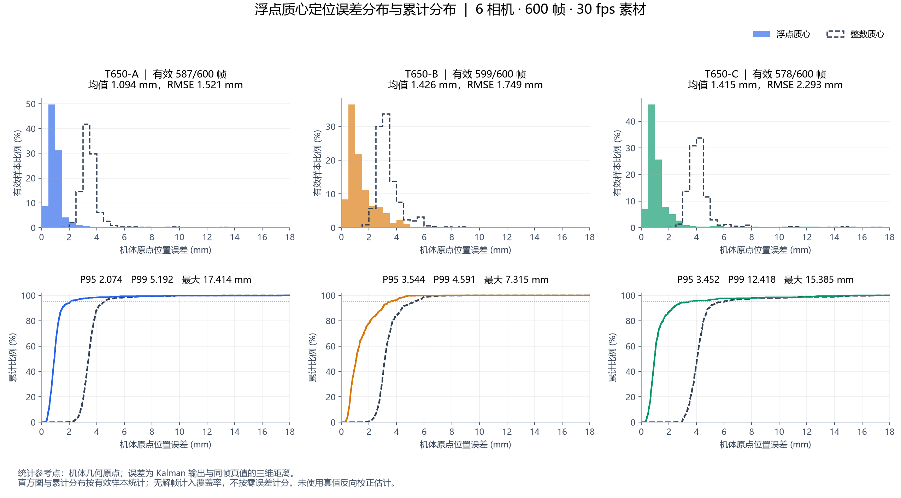
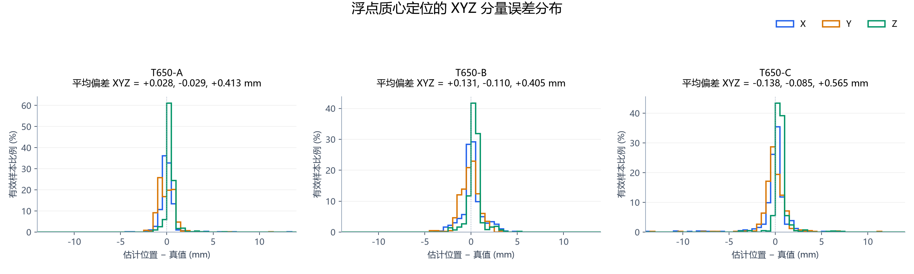

# 第二轮优化：尾延迟与浮点质心试验

## 结论

**还能优化，但“计算更快”和“定位更准”要分别验证。**

- 默认整数模式的中心计算进一步减负，完整 1,800 组输出与上轮版本逐位相同。
- 浮点质心在本段视频上显著减少位置均值和 Z 偏差，但覆盖率略降、A 的最大误差增加；
  因此只作为**显式可选模式**，不自动替换默认。
- 这些测试仍使用六路 30 fps 仿真视频/其点缓存，不能替代原生 60 fps 真机与长时间运行验收。

## 1. 默认计算路径的优化与计时

本轮 profile（120 帧）表明，跨相机候选搜索和刚体定位仍是主要成本，分别约占
总融合累计时间的 43% 和 45%。此次没有降低分辨率、减少机体、截断候选或修改门限：

1. 二维观测的有限值检查改为规则 N×2 数组一次检查；缺失点不会被填成零。
2. 只有一个极线候选时免去无意义排序；多候选继续使用原来的 argsort 和遍历次序。
3. 每相机的像素坐标元组只生成一次，复用于根点筛选。
4. Kabsch 的局部标记中心/中心化坐标按**值快照**缓存，原地修改模板也会刷新；
   缓存最多保留 64 个局部点集，不缓存跨帧观测或未来信息。

同一 i7-1255U、Windows 11、Python 3.13.5、OpenCV 5.0.0，中心 OpenCV 线程数为 1。
输入均为 `tracking_optimized.json`，预热 10 帧后运行三次完整 600 帧。

| 本轮同机对照 | 均值 ms | P95 ms | P99 ms | 完整输出回归 |
|---|---:|---:|---:|---:|
| 优化前 `fusion_round2_before.json` | 12.695 | 15.798 | 17.182 | 1,800/1,800 |
| 优化后 `fusion_round2_final.json` | **10.226** | **13.736** | **15.069** | **1,800/1,800 逐位相同** |

均值改善约 19.5%；本轮 CPU 服务时间 P99 进入 16.667 ms 的 60 Hz 预算。
但仍有 **6/1,800 组（0.33%）**超过该预算，最大耗时 23.275 ms。
三次测量均值为 6.56/12.00/12.12 ms，存在明显运行状态差异；所有帧均保留在统计中，
不选最快一次或删除慢帧。计时不含相机采集、图像检测、网络、组帧等待与 UI。

历史第一轮的 14.864 ms/P99 23.768 ms 是另一次测试，不与本轮的不同机器状态混为
同一次对照。还需要真实负载下的固定节拍、有界队列和至少 30 min 持续测试，才可判断
稳定的端到端 60 Hz 能力。

复现：

```powershell
.\.venv\Scripts\python.exe tools\benchmark_fusion.py --cache out\rig3\tracking_optimized.json --repeats 3 --out out\rig3\fusion_round2_final.json --baseline-report out\rig3\fusion_round2_before.json --cpu-label "Intel Core i7-1255U (10 cores, 12 threads)"
```

其他设备应建立自己的基准；源码/输入哈希、每轮和逐帧耗时均保存在报告中。

## 2. 浮点质心：减小像素截断偏差

旧路径把连通域中心 `centers` 强制转为 `int`，非整数值会向下截断；新可选模式直接保留
检测器算出的浮点值。面积筛选、阈值 140、9×9 模糊、标定、灯阵、时间关联和 Kalman
滤波都没有改动，也没有根据真值估计/减去一个补偿常数。
（当时文档把输出记作 `statePre`；该字段实际是后验，见
[第三轮 §6](spike_robustness.md)。）

`subpixel` 的含义是**未取整的连通域几何质心**，不是高斯拟合或光学中心校准。
实际精度仍受光斑形状、曝光、反光、畸变和像素采样影响。

完整六路视频 600 帧重跑结果，位置误差为机体原点三维距离，单位 mm。
分位数按有解帧统计，覆盖率另列：

| 机体/模式 | 覆盖率 | 均值 | P95 | P99 | 最大 |
|---|---:|---:|---:|---:|---:|
| A 整数 | 98.33% | 3.511 | 4.518 | 6.899 | 13.110 |
| A 浮点 | **97.83%** | **1.094** | **2.074** | **5.192** | **17.414** |
| B 整数 | 100.00% | 3.371 | 5.275 | 6.289 | 8.709 |
| B 浮点 | **99.83%** | **1.426** | **3.544** | **4.591** | **7.315** |
| C 整数 | 96.50% | 4.301 | 6.000 | 13.991 | 17.005 |
| C 浮点 | **96.33%** | **1.415** | **3.452** | **12.418** | **15.385** |



### 偏差与姿态

| 机体 | Z 平均偏差，整数→浮点 mm | 原始几何位置均值，整数→浮点 mm | 四标记旋转均值，整数→浮点 ° |
|---|---|---|---|
| A | +3.317 → **+0.413** | 3.474 → **0.616** | 0.212 → **0.100** |
| B | +2.908 → **+0.405** | 3.398 → **1.126** | 0.383 → **0.250** |
| C | +3.841 → **+0.565** | 4.275 → **1.067** | 0.361 → **0.191** |



这些结果支持“像素截断是主要 Z 偏差来源之一”的判断，但并未完全消除偏差。
速度 MAE 基本保持在 0.036/0.042/0.040 m/s；更密或更精确的位置观测不意味着
当前差分/低通结构的速度和加速度误差同幅度下降。

### 为什么不设为默认

- A/B/C 分别少了 3/1/1 个有效输出；不能仅看均值就忽略覆盖下降。
- 三机同时有输出的比例从 95.00% 降到 94.50%。在两种模式**共同有效的同一批帧**上，
  A/B/C 均值仍分别由 3.508/3.371/4.291 mm 降到 1.094/1.426/1.410 mm
  （587/599/577 帧配对），说明均值改善不是靠丢掉少数坏帧造成的。
- A 的最长无解段从 3 帧变为 4 帧，随后第 545 帧的先验位置误差增大到 17.414 mm。
- 浮点质心会改变极线候选和几何匹配；它不是旧整数输出的数值等价加速。
- 目前只验证了这一段理想成像的视频，没有真实传感器噪声/曝光变化/机械挠曲或更大机群。

因此默认继续使用 `integer`。需要精度优先的试验时显式选择 `subpixel`，并同时监控
覆盖、尾部、重捕获行为和同步质量；保留同参考点基线对比。

## 3. 使用可选模式

### 独立定位与计分

```powershell
.\.venv\Scripts\python.exe tools\evaluate_multi_video.py --centroid-mode subpixel --frames 0-599 --out-prefix out\rig3\tracking_subpixel
.\.venv\Scripts\python.exe tools\accuracy_stats3.py --cache out\rig3\tracking_subpixel.json --out-prefix out\rig3\accuracy_subpixel
.\.venv\Scripts\python.exe tools\plot_tracking_distribution.py --cache out\rig3\tracking_subpixel.json --baseline out\rig3\tracking_optimized.json --out-prefix out\rig3\position_error_subpixel --allow-centroid-change
```

分布比较必须显式允许质心模式变化；仍要求标定、视频哈希、真值、帧序和其他参数相同。
直接运行源无关流水线也可以加 `--centroid-mode subpixel`。

### 实时应用

启动后端前设置 `MOCAP_CENTROID_MODE=subpixel`；默认值为 `integer`。
绘制标注时只对显示坐标取整，传入融合的点仍为浮点。`/api/tracking-config` 上报所选模式。
不要在连续跟踪中途更改模式；先停止跟踪/重启后端并重新初始化。

### 边缘切分回归

```powershell
.\.venv\Scripts\python.exe tools\edge_equivalence_check.py --centroid-mode subpixel --frames 0-599 --reference out\rig3\tracking_subpixel.json --out out\rig3\edge_equivalence_subpixel.json
```

各节点保持同一检测版本和模式；点包不再次量化，标定槽位与曝光时间仍按原协议校验。
本次六个本地进程独立解码的完整回归 **600/600 组像素、点和融合输出一致**，与同版浮点
视频结果也 600/600 一致。最大点包 843 B；含约定 UDP/IPv4 传输开销的六路点流外推到
60 Hz 为约 2.266 Mbps，加 6×6 Mbps 的监控码率假设为约 38.266 Mbps。
这些是软件分割/序列化验证和容量核算，不是六块 Pi 或物理网络的实测。

## 4. 下一步优先级（尚未实现）

1. **重捕获策略**：区分连续跟踪与丢失后的更新，评估更合理的测量质量/协方差和创新检验，
   避免错误测量或过旧速度扩大先验误差。直接改成输出 `statePost` 会改变输出语义，需另做验证。
   → **已在[第三轮](spike_robustness.md)完成**：`reacquire_inflation` 按丢帧数膨胀协方差；
   同时修正了输出语义（读 `statePre` 实际拿到的是被 `correct()` 就地覆盖的后验）。
2. **预测投影候选**：用最近刚体位姿预测每路标记位置，正常跟踪时优先局部关联，失锁时全局
   搜索回退。它可能改变身份/覆盖，不能当作无损剪枝。
3. **鲁棒位姿联合优化**：对误匹配视角加质量权重/鲁棒损失，直接优化跨相机重投影的刚体
   SE(3)，重点考察 C 的长尾；需要同时测算增加的计算成本。
4. **部署尾延迟**：将标注、视频编码与定位解耦；在真实节点/网络/温稳环境下测试，不用
   30 fps 素材翻倍播放来替代 60 fps 采集。

不优先盲目上 GPU：当前热点多为小数组与候选管理，传输和调度开销可能超过收益。
如需更大机群，再用实测决定 C++/Rust 内核或并行方案，保持有状态跟踪的时间顺序。

## 5. 文件

- `out/rig3/fusion_round2_before.json`、`fusion_round2_after.json`（阶段记录）、`fusion_round2_final.json`：计时与回归。
- `out/rig3/fusion_round2_profile_before.json`：120 帧热点 profile，插桩时间不作为吞吐。
- `out/rig3/tracking_round2.*`：新默认路径完整视频重跑；整数精度保持不变。
- `out/rig3/tracking_subpixel.*`、`accuracy_subpixel.*`：浮点质心定位/测速/姿态。
- `out/rig3/position_error_subpixel.*`、`position_error_subpixel_xyz.png`：分布、偏差与基线。
- [上一轮中心优化](fusion_optimization.md) · [整数基线误差分布](position_accuracy_optimized.md) · [部署设计](edge_architecture.md)。
