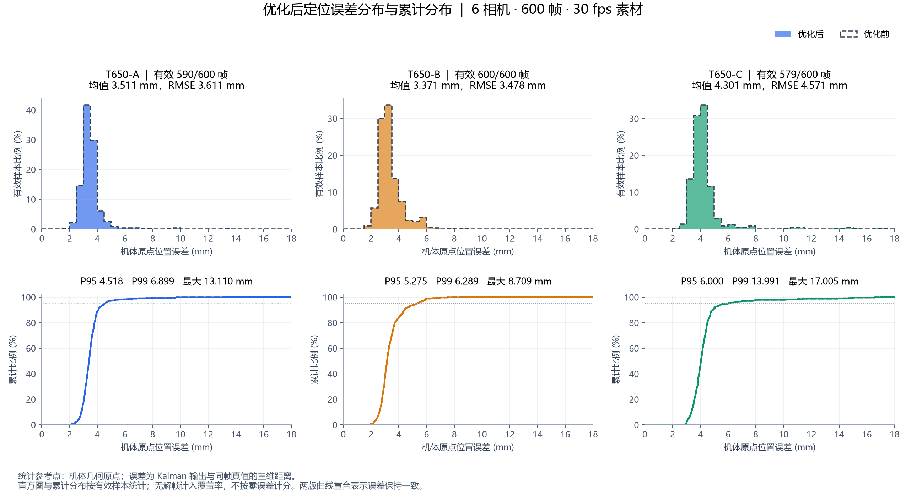
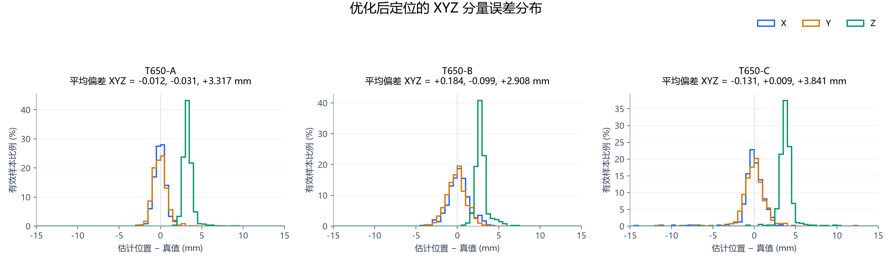

# 优化版定位误差分布

对优化版重新解码六路干净仿真视频，完整运行 0…599 帧（20 s、30 fps）。
参考点为机体几何原点；位置误差为 Kalman `pos` 与同帧独立轨迹真值的三维距离。

此页是整数质心基线，第二轮默认速度优化仍保留同样结果。浮点质心的实验分布、覆盖率
和最大误差取舍见 [进一步优化](further_optimization.md)，它不是默认配置。

## 1. 分布结果

单位：mm。分位数按有效输出统计，无解帧另计覆盖率。

| 机体 | 有效帧 / 覆盖率 | 均值 | 中位数 | P95 | P99 | 最大 |
|---|---|---:|---:|---:|---:|---:|
| T650-A | 590/600 · 98.33% | 3.511 | 3.417 | 4.518 | 6.899 | 13.110 |
| T650-B | 600/600 · 100% | 3.371 | 3.154 | 5.275 | 6.289 | 8.709 |
| T650-C | 579/600 · 96.50% | 4.301 | 4.038 | 6.000 | 13.991 | 17.005 |



- A/B 的主体分布集中在约 3–4 mm；C 集中在约 4 mm，尾部更长。
- 有效帧中误差 >10 mm 的比例：A **0.17%**（1 帧）、B **0%**、C **2.07%**（12 帧）。
- 把无解也作为未达标，全部 600 帧中同时“有解且 ≤5 mm”的比例为
  A **95.50%**、B **93.67%**、C **88.00%**。
- A/C 最长连续无解均为 3 帧，即 0.1 s；三机同时有有效位置的帧占 95%。
- A 最大误差在第 545 帧（18.167 s），此前 542–544 帧无解；C 最大误差在第 45 帧
  （1.500 s），此前 43–44 帧无解。尾部需要关注重捕获阶段的先验输出。

## 2. XYZ 分量与系统偏差

以下均值为“估计 − 真值”，单位 mm；正 Z 表示估计高度偏高。

| 机体 | X 均值 | Y 均值 | Z 均值 | XYZ 标准差 |
|---|---:|---:|---:|---|
| T650-A | −0.012 | −0.031 | **+3.317** | 0.858 / 0.950 / 0.625 |
| T650-B | +0.184 | −0.099 | **+2.908** | 1.267 / 1.195 / 0.746 |
| T650-C | −0.131 | +0.009 | **+3.841** | 1.708 / 1.560 / 0.876 |



主要系统偏差在 Z 方向。进一步提升精度应优先量化整数质心/像素映射、成像与标定偏差，
并评估重捕获后的滤波输出；本次没有用真值反向添加常数补偿。

## 3. 原始几何位置与滤波位置

原始位置来自四标记或时间先验消歧后的 `pose_t`，滤波位置为 `correct()` 之后的后验状态
（代码显式读 `statePost`；本文标题沿用当时的 `statePre` 说法，两者是同一个向量）。

| 机体 | 原始均值 / P95 / 最大 mm | 滤波均值 / P95 / 最大 mm |
|---|---|---|
| T650-A | 3.474 / 4.416 / 6.253 | 3.511 / 4.518 / 13.110 |
| T650-B | 3.398 / 4.578 / 6.011 | 3.371 / 5.275 / 8.709 |
| T650-C | 4.275 / 5.288 / 20.688 | 4.301 / 6.000 / 17.005 |

滤波并不保证每一帧的位置误差都变小；本实现同时估计 p/v/a 并保留先验输出约定。
速度 MAE A/B/C 为 0.036/0.043/0.041 m/s，四标记姿态旋转均值为 0.212°/0.383°/0.361°。

## 4. 与优化前逐帧对比

同一视频、标定、机体、时间轴和真值下：

- 三机的有效/无解帧完全相同。
- **所有有效帧的滤波位置完全相同**，最大位置变化为 **0 mm**，所以两版分布曲线重合。
- 原始位置最大差约 `2.24×10⁻¹² mm`，属于 SVD 实现/批量计算的浮点舍入。
- 另有 3 次全序列的中心计算回归（1,800/1,800 帧）验证身份、顺序、模式、失锁和全部数值字段。

加速收益及 60 Hz 尾延迟边界见 [中心融合优化](fusion_optimization.md)。这些精度数值是本段
30 fps 仿真素材的经验分布，不代表已经完成原生 60 fps 真机采集验收。

## 5. 复现与文件

```powershell
.\.venv\Scripts\python.exe tools\evaluate_multi_video.py --input video --position-reference body_origin --max-err 6 --max-speed 10 --frames 0-599 --out-prefix out\rig3\tracking_optimized
.\.venv\Scripts\python.exe tools\accuracy_stats3.py --cache out\rig3\tracking_optimized.json --out-prefix out\rig3\accuracy_optimized
.\.venv\Scripts\python.exe -m pip install matplotlib
.\.venv\Scripts\python.exe tools\plot_tracking_distribution.py
.\.venv\Scripts\python.exe -m unittest tests.test_tracking_distribution
```

- `out/rig3/tracking_optimized.{json,csv}`：新算法逐帧轨迹、原始/滤波误差、姿态与来源哈希。
- `out/rig3/accuracy_optimized.{json,csv}`：位置、速度、姿态汇总及逐帧数据。
- `out/rig3/position_error_distribution.{json,csv}`：分位数、XYZ 偏差、缺失帧、最大误差帧和配对对比。
- `out/rig3/position_error_distribution.png`、`..._xyz.png`：本页两张图。
- `out/rig3/tracking_from_video.json`：优化前回归基线。
