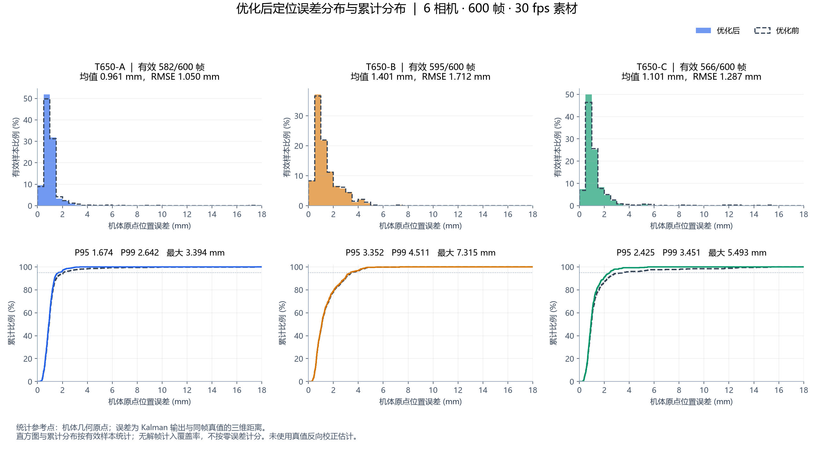
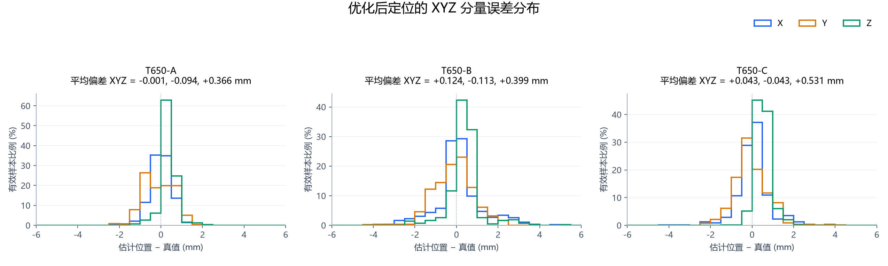

# 第三轮优化：失锁重捕获与参考三角形形状门

## 结论

上一轮遗留的最大误差并不是"检测偶尔错一个像素"，而是两类可区分的失效：

1. **Kalman 外推**：短时丢帧后，滤波器把丢帧前的速度继续外推，而机体在丢帧期间正在减速，
   于是"测量很准、滤波输出很差"（A 第 545 帧：原始 0.62 mm，滤波 17.41 mm）。
2. **参考三角形被三角化畸变**：三标记几何在个别帧被拉弯 7–9 mm，位姿拟合仍能给出低重投影
   误差，但机体原点随之偏移 10–20 mm，事后把滤波输出也带偏（C 的多数长尾都属此类）。

两项默认启用的改动分别针对这两类失效：

| 改动 | 默认 | 效果（浮点质心，完整 600 帧） |
|---|---|---|
| `rigidity_tol = 2 mm`：参考三角形形状残差门 | 开 | 原始最大误差 20.25→4.45 mm；滤波 P99 6.90→4.15 mm |
| `reacquire_inflation = 5.0`：重捕获时按丢帧数膨胀协方差 | 开 | 滤波最大误差 24.60→7.32 mm（只开形状门时反而更差） |

两者合起来把 A/B/C 的最大误差从 17.41/7.32/15.39 mm 压到 **3.39/7.32/5.49 mm**，
代价是覆盖率下降 0.7–2.0 个百分点（形状门丢弃了它判定为畸变的帧）。

**这仍然是仿真视频上的结果**：没有运动模糊、传感器噪声、镜头畸变、杆件挠曲和真实网络，
不能当作现场精度承诺；也没有用真值做任何常数补偿。速度/姿态精度基本不变（见 §5）。

## 1. 尖峰归因（先量后改）

用 `out/rig3/tracking_subpixel.json` 逐帧对齐 `objects`（原始几何解）、`filtered_objects`
（Kalman 输出）与 `reference`（真值），按 `pose_triangle_rmse_m`（只用参考三角形三点做刚体
拟合的残差）分桶：

| 参考三角形残差 | 帧数 | 原始均值 | 原始 P95 | 滤波均值 | 滤波 P95 | 滤波最大 |
|---|---:|---:|---:|---:|---:|---:|
| < 1 mm | 1491 | 0.673 | 1.142 | 1.075 | 2.506 | 8.850 |
| 1–2 mm | 135 | 1.557 | 2.845 | 1.707 | 3.595 | 9.739 |
| 2–3 mm | 96 | 2.360 | 3.967 | 2.392 | 4.633 | 7.315 |
| 3–5 mm | 25 | 2.810 | 3.780 | 3.221 | 5.386 | 9.004 |
| 5–100 mm | 9 | **12.978** | 19.093 | **10.779** | 14.913 | 15.385 |

误差随形状残差单调上升，而且**只有残差 > 5 mm 的 9 帧产生了 > 10 mm 的原始误差**。
这说明形状残差是一个弱但单调的可用证据：它不能证明"这帧一定对"，但能标出"这帧一定不能用"。

丢失帧（`gap ≥ 1`）单独看：

```text
body=0 frame=545 gap=4 kf=17.414 raw=0.621 mode=rigid mk=4 rmse=0.69
body=2 frame= 45 gap=2 kf=15.155 raw=1.197 mode=rigid mk=4 rmse=0.40
body=0 frame=546 gap=0 kf= 9.739 raw=0.841 mode=triangle3 mk=3 rmse=1.26
```

第 545 帧之前连续 4 帧无解（第 541–544 帧），机体速度由约 1.5 m/s 衰减到 1.26 m/s，
滤波沿旧速度外推后落到真值前方 17 mm；同一帧的原始解只有 0.62 mm。也就是说：
**丢帧后的第一帧，输出的主要成分是外推，而不是新测量。**

## 2. 改动一：参考三角形形状门 `rigidity_tol`

### 为什么门限必须落在"毫秒级"而不是"厘米级"

3 个点构成的刚体拟合有 6 个自由度，7 个约束（3 点 × 3 维减 2 个退化）。于是：

- **弯折单个顶点**（把一个标记推离 10 mm）几乎完全被拟合吸收，残差只有 **0.09 mm**，
  这是二阶量；用它当门限等于没有门限。
- **整体缩放**不能被旋转/平移吸收，残差是**一阶量**。

实测（`tests/test_mocap_adapter.py::TrackingRobustnessTests`）：

| 参考三角形缩放 | 形状残差 | 形状门 2 mm | 无门时的位置误差 |
|---|---:|---|---:|
| ×1.005 | 0.94 mm | 接受 | 0.93 mm |
| ×1.010 | 1.87 mm | 接受 | 1.86 mm |
| ×1.020 | 3.74 mm | **拒绝** | 3.72 mm（仍被当作正常解上报） |

所以门限的有效量级由**标定/像素量化本身**决定，实测形状残差分布为：

| 数据集 | P50 | P90 | P95 | P99 | 最大 |
|---|---:|---:|---:|---:|---:|
| 浮点质心 | 0.386 | — | 1.398 | 2.020 | 9.4 |
| 整数质心 | 0.766 | — | 1.604 | 2.411 | 9.4 |

`2 mm` 大致等于两者 P99：正常情况下几乎不丢帧，畸变帧一定被拒。

### 门限扫描（离线逐位重放，含 5× 膨胀）

```text
gate=off    samples=1764  raw mean=0.937 max=20.253 | kf mean=1.249 p99=5.361 max=19.505
gate=2.0mm  samples=1743  raw mean=0.851 max= 4.450 | kf mean=1.157 p99=4.148 max= 7.315
gate=2.5mm  samples=1750  raw mean=0.857 max= 4.450 | kf mean=1.165 p99=4.147 max= 7.315
gate=3.0mm  samples=1752  raw mean=0.866 max=12.663 | kf mean=1.174 p99=4.170 max=12.709
gate=5.0mm  samples=1755  raw mean=0.874 max=12.663 | kf mean=1.182 p99=4.205 max=12.710
```

2.0–2.5 mm 都在同一档；3 mm 起就放过了一个 12.7 mm 的畸变帧（C 第 570 帧）。
覆盖代价：2 mm 丢 21 个样本（占原本可用的 1764 个的 1.2%），5 mm 只丢 9 个；
**上限只能换到 12 mm 的尾部**，所以取 2 mm。

### 实现位置

门在 `locate_bodies()` 里、位姿已经拟合之后、参考点被改写之前执行；被拒帧**整帧丢弃**
（与 `max_err` 的行为一致），不退化到三点解，因为被拉弯的正是这三点本身。
诊断字段 `pose_triangle_rmse_m` 保留在 `objects` / `filtered_objects` 里，
可以事后统计而不必猜测。

库层函数 `locate_bodies(..., rigidity_tol=None)` 默认**关闭**，以保持上游行为可复现；
应用层 `TrackingPipeline`、`tools/evaluate_multi_video.py` 和实时后端（`helpers.py`）默认
`2 mm`。关闭方式：`MOCAP_BODY_RIGIDITY_TOL=0` 或 `--rigidity-tol 0`。

## 3. 改动二：重捕获协方差膨胀 `reacquire_inflation`

### 问题

`reacquire_gap_s = 0.5 s` 以内的丢帧走的是"预测 + 更正"，而不是重置。丢帧期间没有测量，
`errorCovPost` 仍停留在上一帧的水平（实测位置方差 0.62，即卡尔曼增益 0.62），
结果是重捕获帧的输出 = 62% 的**旧外推** + 38% 的**新测量**。机体若在丢帧期间减速，
外推项就是纯误差。

### 做法

按丢帧数 `missed = round((t − t_last)·fps) − 1` 膨胀未被观测的状态：

```text
errorCovPost[:3,:3] += k·missed·R_pos
errorCovPost[3:6,3:6] += k·missed·R_vel
```

以**测量噪声矩阵 R** 为单位，而不是绝对方差，这样门限与 `Q/R` 的任意整体缩放无关；
`k = 5`（`reacquire_inflation`），`k = 0` 即完全关闭。

### 标定

单轴仿真：机体 1.2 m/s 巡航，第 20 帧起急减速到 0.06 m/s，第 20–23 帧完全无观测，
第 24 帧重捕获：

| 设置 | 重捕获帧误差 | 之后最大误差 |
|---|---:|---:|
| `reacquire_inflation = 0` | **40.25 mm** | 40.25 mm |
| `reacquire_inflation = 5` | **0.63 mm** | 2.05 mm |

两种设置在稳态段（第 5–19 帧）逐位相同，说明该改动**只在丢帧后生效**，
不影响正常跟踪，也不改变首次初始化行为。

### 为什么"只开形状门"反而更差

形状门会丢掉畸变帧，于是丢帧段变长（本数据 C 最长无解段 3→5 帧），
旧外推在更长的时间里累积 —— 滤波最大误差从 17.41 mm 涨到 24.60 mm。
两项改动是互补的：**门负责不喂坏测量，膨胀负责不被旧状态拖住**。

## 4. 完整视频 A/B（6 机位 × 600 帧，实际像素）

评估口径不变：机体原点三维距离，30 fps 采样时间轴，分位数只按有解帧统计。

### 浮点质心（`--centroid-mode subpixel`）

| 机体 | 覆盖 前→后 | 均值 前→后 | P95 前→后 | P99 前→后 | 最大 前→后 |
|---|---|---|---:|---:|---:|
| A | 97.83 → **97.00** | 1.094 → **0.961** | 2.074 → **1.674** | 5.192 → **2.642** | 17.414 → **3.394** |
| B | 99.83 → **99.17** | 1.426 → **1.401** | 3.544 → **3.352** | 4.591 → **4.511** | 7.315 → 7.315 |
| C | 96.33 → **94.33** | 1.415 → **1.101** | 3.452 → **2.425** | 12.418 → **3.451** | 15.385 → **5.493** |

三机同时有输出：94.50% → 92.00%。`> 5 mm` 的有效帧比例：A 1.19→0.00%、B 0.33→0.34%、
C 3.63→0.53%。

### 整数质心（默认）

| 机体 | 覆盖 前→后 | 均值 前→后 | P95 前→后 | P99 前→后 | 最大 前→后 |
|---|---|---|---:|---:|---:|
| A | 98.33 → **97.17** | 3.511 → **3.426** | 4.518 → **4.275** | 6.899 → **4.875** | 13.110 → **6.523** |
| B | 100.00 → **97.50** | 3.371 → **3.353** | 5.275 → **5.177** | 6.289 → **6.039** | 8.709 → 8.709 |
| C | 96.50 → **94.17** | 4.301 → **4.045** | 6.000 → **4.998** | 13.991 → **6.013** | 17.005 → **6.360** |

三机同时有输出：95.00% → 90.33%。整数模式下形状残差本身更大（P99 2.41 mm），
所以同一 2 mm 门限会多丢约 1 个百分点的帧；均值仍然下降，说明丢掉的确实是差帧。





### 结果的可信度检查

- **在线与离线逐位一致**：离线重放器（`geom_replay.py` + `kf_sweep.py`）与在线
  `evaluate_multi_video.py` 的 A/B 极值完全相同（A 3.394、B 7.315、C 5.493 mm），
  说明这次改善不是随机波动，也不是评估口径变化。
- **配对比较**：在两种设置**共同有效**的帧上，浮点 A/B/C 均值 1.079/1.413/1.212 →
  0.961/1.401/1.101 mm。改善不是靠丢帧"藏"起来的。
- 标定、视频哈希、真值来源、帧序、检测门限完全一致，只有两个新参数不同；
  `tools/plot_tracking_distribution.py` 会强制这条约束。

## 5. 测速与姿态

| 机体 | 速度 MAE 浮点（前→后） m/s | 姿态 rigid 均值 浮点（前→后） ° | 姿态 rigid 均值 整数（前→后） ° |
|---|---|---|---|
| A | 0.035 → 0.035 | 0.100 → **0.095** | 0.212 → **0.209** |
| B | 0.043 → 0.042 | 0.250 → **0.247** | 0.383 → **0.378** |
| C | 0.041 → 0.036 | 0.191 → **0.141** | 0.361 → **0.310** |

速度和姿态基本不变，这是预期内的：两项改动只影响"坏帧/丢帧后第一帧"，
不影响稳态增益和低通结构。C 的姿态改善来自那些畸变帧不再进入 4 点 Kabsch。

## 6. 顺带修正：输出的其实是后验，不是先验

历史文档一直写"输出取上游 `statePre`（先验）"。实测 `cv2 5.0` 的 `correct()` 会**就地覆盖**
`statePre`，所以读 `statePre` 得到的其实是后验；旧代码"输出先验"的说法与实际行为不符。
现在显式读 `statePost` 并改写文档，输出数值与旧版逐位相同（回归测试与完整视频均验证），
只是语义不再自相矛盾。

配置里的 `kalman_output` 字段同步改为
"posterior state of the accepted capture (p, v, a); velocity additionally Butterworth-filtered"。

## 7. 可选工具：`extra_refit_margin`（默认关闭）

`extra_refit_margin`（4 点 Kabsch 残差相对 3 点的增量门）用于拒绝"落在 `extra_tol` 内、
但与模板几何不符"的额外标记（例如它其实属于另一架机）。离线 A/B：

| 设置 | 原始均值 | 原始最大 | 滤波均值 | 滤波最大 |
|---|---:|---:|---:|---:|
| 基线 | 0.937 | 20.253 | 1.312 | 17.414 |
| +1 mm | 0.957 | 20.253 | 1.337 | 17.414 |
| +2 mm | 0.940 | 20.253 | 1.316 | 17.414 |

单独启用时均值略升，且没有清掉任何真实尖峰 —— 本数据的额外标记误关联并**不是**主要失源
（第 38 帧那类畸变帧里，额外标记残差 7.27 mm 与三角形残差 7.92 mm 同源，是三角化本身坏了）。
因此保留为运维可选工具，默认 `None`。

## 8. 复现

```powershell
# 完整视频评估（新默认参数）
.\.venv\Scripts\python.exe tools\evaluate_multi_video.py --input video --position-reference body_origin `
    --max-err 6 --max-speed 10 --frames 0-599 --centroid-mode subpixel `
    --out-prefix out\rig3\tracking_subpixel_v3

# 与上轮基线做配对比较（只允许这两个参数不同）
.\.venv\Scripts\python.exe tools\plot_tracking_distribution.py `
    --cache out\rig3\tracking_subpixel_v3.json --baseline out\rig3\tracking_subpixel.json `
    --allow-change rigidity_tolerance_m --allow-change reacquire_inflation `
    --allow-change kalman_output --allow-change rigidity_gate_description `
    --out-prefix out\rig3\cmp_subpixel_v3

# 测速/姿态统计
.\.venv\Scripts\python.exe tools\accuracy_stats3.py --cache out\rig3\tracking_subpixel_v3.json `
    --out-prefix out\rig3\accuracy_subpixel_v3

# 单元测试（含形状门与重捕获膨胀的标定用例）
.\.venv\Scripts\python.exe -m unittest discover -s tests
```

关闭其中任意一项以做现场对照：`--rigidity-tol 0`、`--reacquire-inflation 0`；
实时后端对应 `MOCAP_BODY_RIGIDITY_TOL=0`、`MOCAP_REACQUIRE_INFLATION=0`。

## 9. 局限与下一步

### 过拟合审计：形状门对传感器噪声的敏感性

2 mm 门是在**干净仿真**的残差分布上定的（恰好 ≈ P99）。它是否能在真实噪声下推广？
对记录的三角化点注入高斯点噪声，在同一套几何 + Kalman（含 5× 膨胀）下重放：

| 注入点噪声 | 门关 有效帧 | 绝对 2 mm 有效帧 | 绝对 2 mm 保留率 | kf 最大（绝对 2 mm） |
|---:|---:|---:|---:|---:|
| 0 mm | 1764 | 1743 | 98.8% | 7.32 mm |
| 1 mm | 1764 | 1698 | 96.3% | 8.12 mm |
| 2 mm | 1764 | **1011** | **57.3%** | 9.28 mm |
| 4 mm | 1764 | **242** | **13.7%** | 12.13 mm |

结论：**绝对 2 mm 门在干净数据上是"过拟合"的**。真实传感器把残差地板抬到 1–2 mm 后，
同一门会把大半"本来正确的噪声帧"误杀（覆盖从 ~99% 塌到 ~57%）。整数质心更危险，
因为其残差地板本就更高（干净 P99 2.41 mm）。

曾评估的**自适应门**（拒绝 `残差 > max(地板, k×滚动中位数)`，中位数跟踪噪声地板）在噪声下
保住覆盖（4 mm 噪声下仍保留 1747 帧 vs 绝对门的 242），但代价是让轻度离群帧通过，
尾部变差（2 mm 噪声下 kf 最大 16.58 vs 绝对门 9.28）。**在这份干净视频上两者几乎等价**
（kf 最大均为 7.32 mm），因此默认不引入自适应门——它是额外复杂度，且真实噪声下的取舍并不更优。

根本原因：形状残差是**二阶量**（弯折单点几乎被刚体拟合吸收），在真实噪声下区分"3 mm 离群帧"
与"3 mm 噪声的正确帧"的能力天然有限。要真正压掉 B@43 这类"通过 2 mm 门的轻度离群被 Kalman
吸收成 7.3 mm"的尾部，正确杠杆是 **Kalman 创新门/鲁棒更新**，而不是再调形状门限。

### 其他局限

1. **覆盖率换尾部**：三机同时可用率为 94.50%→92.00%（浮点）/95.00%→90.33%（整数）。
   如果现场更在意连续性而不是尾部，应把门限放宽到 2.5–3 mm，或改为"降权"而不是"丢弃"
   （需要几何层向 Kalman 传递每帧测量质量，是下一步的接口改动）。
2. **门限是绝对量**：2 mm 由本套标定/分辨率实测得出。更换镜头、距离、标记尺寸或改用
   亚像素拟合后必须重测残差分布，不能直接沿用（见上方噪声审计）。
3. **重捕获只有位置/速度协方差**：加速度分量没有同步膨胀；急减速场景下加速度仍会滞后。
4. **没有真机数据**：仿真视频的畸变帧来自三角化本身，真实系统的畸变来源（滚动快门、
   反光、杆件振动）可能给出不同的残差分布。
5. **残留尾部是 Kalman 吸收了轻度离群**（B@43：raw 4.45 mm → kf 7.32 mm）。这类帧
   通过形状门、raw 只高几毫米；正确杠杆是 Kalman 创新门/鲁棒更新（对远超先验的测量降权），
   而不是再收紧几何门。预测投影候选、鲁棒 SE(3) 联合优化同样未实现。

## 10. 文件

- `out/rig3/tracking_subpixel_v3.json`、`tracking_integer_v3.json`：新默认参数完整视频结果。
- `out/rig3/cmp_subpixel_v3.*`、`cmp_integer_v3.*`：与上一轮的配对比较（JSON/CSV/PNG）。
- `out/rig3/accuracy_subpixel_v3.*`、`accuracy_integer_v3.*`：定位/测速/姿态统计。
- `out/video/fused_tracking_error_body_origin.mp4`：由 `tracking_subpixel_v3.json` 重制的误差曲线视频。
- 代码：`adapters/low_cost_mocap/multi_body.py`（形状门、诊断字段）、
  `.../api/KalmanFilter.py`（协方差膨胀、显式后验输出）、
  `adapters/low_cost_mocap/tracking_pipeline.py`、`tools/evaluate_multi_video.py`。
- [第二轮：尾延迟与浮点质心](further_optimization.md) · [部署设计](edge_architecture.md) ·
  [算法数据流](dataflow_and_algorithms.md)。
